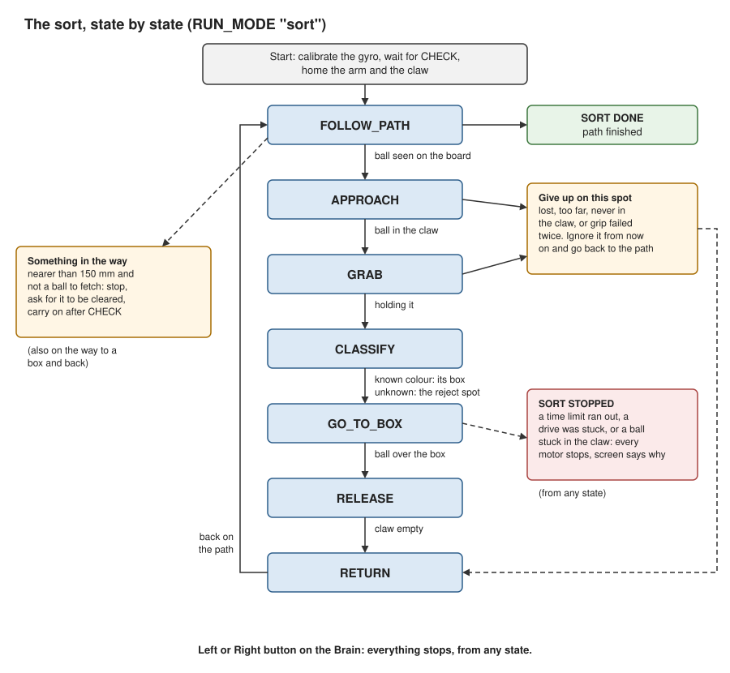
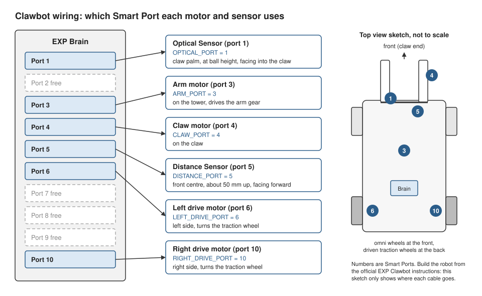

# vex-exp-pick-and-sort

A VEX EXP Clawbot that sorts balls by colour. It drives a path on a 300 mm
grid board, finds a ball with a Distance Sensor, picks it up with the claw,
reads its colour with an Optical Sensor, drops it in the box for that
colour, and goes back to the path to look for the next one.

**UNTESTED ON HARDWARE.** Everything here has only run in the laptop
simulator and the unit tests. Before running it on a robot, work through
the [bring-up checklist](docs/BRINGUP.md).

## What it does

| Milestone | What | State |
|---|---|---|
| M1 | Project layout, settings file, hardware interface, path following, simulator, tests | Done, simulator only |
| M2 | Distance and colour sensing, colour calibration | Done, simulator only |
| M3 | Pick-and-sort behaviour with timeouts and recovery | Done, simulator only |
| M4 | This guide, the wiring diagram and the PDF | Done |

The program has five modes, chosen with `RUN_MODE` in
`config/settings.py`: three bring-up checks, a plain drive along a path,
and the sort itself. They are described under [Running it](#running-it).

The colour sorting is a calibrated rule, not machine learning. You record
the Optical Sensor with the claw empty and with each ball, and the robot
then picks the nearest recorded hue, or says "unknown" when nothing is
close or the readings disagree. Nothing in the program learns or changes
by itself while it runs.

## How it works



The sort is a state machine in [src/mission.py](src/mission.py). The Brain
screen shows the state and the colour the whole time.

| State | What the robot does |
|---|---|
| FOLLOW_PATH | Drives `SORT_PATH`, watching the Distance Sensor |
| APPROACH | Drives slowly up to the ball, then creeps until the Optical Sensor in the claw sees it |
| GRAB | Closes the claw and checks it is holding something |
| CLASSIFY | Reads the colour |
| GO_TO_BOX | Lines up with that colour's box, raises the arm and moves in |
| RELEASE | Opens the claw and checks the ball has gone |
| RETURN | Backs out, lowers the arm and goes back to where it left the path |

Every state has a time limit. When something goes wrong:

- **Object not found**: if it is lost from view, too far, or never reaches
  the claw, the robot gives up on that spot, goes back to the path and
  ignores anything near the spot from then on.
- **Grip failed**: it opens, backs off and tries once more, then gives up
  as above.
- **Colour unknown**: the ball goes to the reject spot, or the robot stops
  with a message if `UNKNOWN_COLOUR_ACTION` is `"stop"`.
- **Something in the way**: the robot stops, asks for the way to be
  cleared, and carries on after CHECK.
- **Anything else** (a stuck drive, a ball stuck in the claw, a time limit):
  every motor stops and the screen says why.

Only objects on the board count as balls. The boxes sit off the board, so
when the Distance Sensor sees one (it does, from column D) the robot
ignores it.

The robot knows where it is by dead reckoning: it adds up how far the
wheels have turned along the heading from the Brain's gyro. Nothing ever
corrects that estimate, so it drifts over a run. See
[Limitations](#limitations).

## Parts list

- A VEX EXP Clawbot, built from the official
  [EXP Clawbot instructions](https://link.vex.com/exp/builds/clawbot)
  (revision 3, listed on the
  [EXP build instructions page](https://www.vexrobotics.com/exp/downloads/build-instructions)).
  That build includes the EXP Brain, the battery and four Smart Motors:
  left drive, right drive, arm and claw.
- One VEX EXP Distance Sensor and one VEX EXP Optical Sensor, with a Smart
  Cable each, and kit parts to mount them.
- Optional: an SD card for the Brain, to keep the colour calibration. It
  must be FAT32 and 32 GB or smaller
  ([SD Card page](https://api.vex.com/exp/home/python/SDcard.html)).
- A computer with VEXcode EXP and a cable to download the program.
- The field: the 300 mm grid board, three boxes 10 in by 10 in (red,
  green, blue), a fourth box or a marked spot for rejects, and balls about
  15 cm across.

## Wiring



| Constant | Port | Device | Mount location | Facing | Height |
|---|---|---|---|---|---|
| `LEFT_DRIVE_PORT` | 6 | Left drive motor | Left side of the chassis, as in the build | - | - |
| `RIGHT_DRIVE_PORT` | 10 | Right drive motor | Right side of the chassis, as in the build | - | - |
| `ARM_PORT` | 3 | Arm motor | On the tower, driving the arm gear | - | - |
| `CLAW_PORT` | 4 | Claw motor | On the claw | - | - |
| `DISTANCE_PORT` | 5 | Distance Sensor | Front of the chassis, centred, looking out through the open claw | Forward, level | About 50 mm above the floor (MEASURE) |
| `OPTICAL_PORT` | 1 | Optical Sensor | Claw palm, centred | Into the claw | Middle of a held ball, about 75 mm up with the arm down (MEASURE) |

The motor ports are the ones the official build uses. The two sensors are
extras for this project, so their ports and mounts are my choice. Ports 2,
7, 8 and 9 are free. If you plug something into a different port, change
the constant in `config/settings.py` to match.

## Setup

On the robot:

1. Build the EXP Clawbot from the official instructions and mount the two
   sensors as in the wiring table.
2. Install VEXcode EXP
   ([Install VEXcode for VEX EXP](https://www.vexrobotics.com/vexcode/install/exp)).
3. Make a new VEXcode EXP Python project, delete the template code, and
   paste in all of [brain/clawbot.py](brain/clawbot.py). If the Brain says
   the program is too big, use [brain/clawbot_compact.py](brain/clawbot_compact.py)
   instead: the same program without the comments.
4. Download it to the Brain.
5. Work through the [bring-up checklist](docs/BRINGUP.md) before anything
   else. A fresh copy is set to `RUN_MODE = "sensor_check"`, which never
   moves a motor.

On a laptop (only needed to change the code or run the tests), with
Python 3.9 or newer:

```bash
python3 -m pip install -r requirements-dev.txt
```

After changing anything in `config/` or `src/`, rebuild the Brain files
and paste the new one into VEXcode:

```bash
python3 tools/build_brain.py
```

## Calibration

Three things need measuring on your own robot. The bring-up checklist
walks through each.

1. **Arm and claw positions** ([step 1b](docs/BRINGUP.md)). The sensor
   check shows the arm and claw positions in motor degrees while you move
   them by hand. These go in `ARM_GRAB_DEG`, `ARM_CARRY_DEG`, `ARM_DROP_DEG`
   and `CLAW_EMPTY_CLOSED_DEG`.
2. **Colours** ([step 1c](docs/BRINGUP.md)). `RUN_MODE = "colour_calibrate"`
   records 20 Optical Sensor readings with the claw empty, then with each
   ball. Hue is 0 to 359 and brightness is a percent
   ([Optical Sensor page](https://api.vex.com/exp/home/python/Sensing/optical-sensor.html)).
   Each colour's reference hue is the average of its readings round the
   colour wheel, and its tolerance is three times how far they spread.
   The brightness gate sits halfway between the empty claw and the darkest
   ball. The result is saved to the SD card and printed in the VEXcode
   console as lines to paste into `config/settings.py`. Until you
   calibrate, the robot uses the middles of the hue ranges VEX gives for
   the sensor's own `color()` method.
3. **Driving** ([step 3](docs/BRINGUP.md)). Check the robot drives the
   distance it should (`WHEEL_TRAVEL_MM`) and turns without swinging past
   the heading (`TURN_KP`).

To check a colour log on a laptop, copy `colour_log.csv` off the SD card
(or the console lines into a file) and run:

```bash
python3 tools/fit_colours.py colour_log.csv
```

It works out the same references the Brain does and shows how each logged
reading would be classified. Put the file in `tests/data/recorded/` and
the tests will check it too.

## Running it

| `RUN_MODE` | What happens | Motors move? |
|---|---|---|
| `"sensor_check"` | Live readings on the screen: arm and claw positions, heading, distance, hue, brightness and colour | Never |
| `"colour_calibrate"` | Records the empty claw and each ball, saves the colour references | Never |
| `"motor_check"` | After CHECK, spins each motor slowly for one second, one at a time | Yes, with the wheels off the ground |
| `"path"` | After CHECK, drives `SELECTED_PATH` | Yes |
| `"sort"` | After CHECK, homes the arm and claw, then sorts along `SORT_PATH` | Yes |

To start, run the program from the Brain and keep the robot still while
the gyro calibrates. In the modes that drive, the screen then says
`CHECK = start`. Press CHECK and take your hand away: the robot waits one
second before it moves. To stop, press Left or Right on the Brain at any
time.

For the sort, put the balls on the west and north sides of `sort_loop`
(north up line A, east along row 6), on the line and at least 450 mm from
a corner. Keep the east and south sides clear, because the robot crosses
them on its way to the boxes. The boxes go where `BOX_POSITIONS` and
`REJECT_POSITION` say: the colour boxes off the east edge of the board and
the reject spot off the south edge.

To see a sort without a robot:

```bash
python3 sim/run_sim.py --mode sort --demo-balls --plot
```

## Changing the path

Paths live in `config/settings.py`. Headings are compass degrees: 0 points
up the board towards row 6, 90 towards column D, and they go clockwise,
like the Brain's gyro. There are two ways to write a path:

- As waypoints, like `ORIGINAL_WAYPOINTS`: a list of (x, y) points in mm.
  The robot turns to face each point and drives straight to it.
- As segments in `SEGMENT_PATHS`: `("turn", h)` turns on the spot to
  heading h, and `("drive", d)` drives d mm straight on (negative drives
  backwards).

For example, a 600 mm square:

```python
SEGMENT_PATHS = {
    "square": [("drive", 600), ("turn", 90), ("drive", 600), ("turn", 180),
               ("drive", 600), ("turn", 270), ("drive", 600), ("turn", 0)],
}
SELECTED_PATH = "square"
```

`SELECTED_PATH` is the path `RUN_MODE = "path"` drives, and `SORT_PATH` is
the one the sort searches along. After a change, look at it in the
simulator and run the tests. They check that every path stays at least
`BOX_CLEARANCE_MM` from every box, including while the claw swings round
in a turn.

```bash
python3 sim/run_sim.py --path square --plot
```

A path for sorting needs long, straight sides that are well apart, because
the robot only sees straight ahead.

## Config reference

Every number the robot uses is in [config/settings.py](config/settings.py),
and [docs/CONFIG.md](docs/CONFIG.md) lists each one with its comment. It
is generated by `tools/make_docs.py`. A test fails if `src/` contains a
tuning number of its own. [docs/ASSUMPTIONS.md](docs/ASSUMPTIONS.md) says
where each value came from, and which ones are estimates to measure.

The settings people change most:

| Setting | What it does |
|---|---|
| `RUN_MODE` | Which of the five modes runs |
| `SELECTED_PATH`, `SORT_PATH` | Which path the drive and the sort use |
| `BOX_POSITIONS`, `REJECT_POSITION` | Where the boxes are, in mm from where line A crosses line 1 |
| `COLOUR_REFERENCES`, `COLOUR_GATE_BRIGHTNESS` | The colour calibration, if there is no SD card |
| `ARM_*_DEG`, `CLAW_EMPTY_CLOSED_DEG` | Arm and claw positions, measured in bring-up step 1b |
| `DRIVE_MAX_PCT`, `TURN_MAX_PCT` | Top speeds, kept slow on purpose |
| `UNKNOWN_COLOUR_ACTION` | `"reject"` to drop unknown colours at the reject spot, `"stop"` to stop |

## Simulator and tests

```bash
python3 -m pytest
```

About 250 tests run in a few seconds. They cover the maths, the paths and
box clearance, the settings, the Distance Sensor filter, the colour rule
on sample readings, the calibration, full simulated sorts with every
failure path, and the Brain file itself. The Brain file is checked for
Python 3.4 syntax (the EXP Brain runs MicroPython 1.13, based on Python
3.4, [MicroPython Libraries page](https://api.vex.com/exp/home/python/Micropython_libraries.html))
and is run against a stand-in for the `vex` module.

The simulator ([sim/sim_hardware.py](sim/sim_hardware.py)) has the same
methods as the real hardware, so the same robot code runs in it. It is
simple on purpose, and passing it does not mean the robot works:

- the sensor values in it, and in `tests/data/`, are made up, not recorded
- it uses the same geometry settings as the robot, so it cannot catch a
  wrong measurement
- balls never roll, the arm has no weight, and the Distance Sensor is a
  single straight ray
- wheel slip and gyro drift are off unless a test turns them on

## Troubleshooting

| What you see | What to check |
|---|---|
| The program will not load, or a memory error | Use `brain/clawbot_compact.py` |
| `Bad RUN_MODE`, `Bad path setting`, `Box on the board` or `Bad unknown rule` | The setting named on the screen in `config/settings.py` |
| `Gyro calibration timed out` | Keep the robot still while it calibrates, then restart |
| `Not started.` | CHECK was not pressed within two minutes |
| A wheel, the arm or the claw moves the wrong way | Its `*_REVERSED` setting. Use the motor check |
| A motor check number is 0 | That motor's cable and port |
| The robot drives a few percent too far or too short | `WHEEL_TRAVEL_MM` |
| Turns swing past the heading and back | Lower `TURN_KP` |
| `Dist` sees something with nothing in front | The Distance Sensor is seeing the claw: move it, or raise `ARM_SEARCH_DEG` |
| `Colour` is always `none` | The ball is not reaching the sensor, or the brightness gate is too high: calibrate again |
| `Colour` is always `unknown` | Calibrate again in the light the robot will sort in |
| `SORT STOPPED` | The second line says why. The table at the end of the [bring-up checklist](docs/BRINGUP.md) says what to check |

## Limitations

**Dead reckoning drifts.** Nothing outside the robot ever corrects its
position estimate, so wheel slip and gyro drift build up over a run. In
the simulator, with one ball of each colour and one unknown:

| Gyro drift | Result |
|---|---|
| none | all 4 balls land in the right place |
| 0.6 degrees a minute | all 4 land |
| 1.2 degrees a minute | the robot counts all 4 as sorted, but one lands beside its box |
| 3 degrees a minute | the robot hits a box on the way in and stops |

**Nothing checks what lands in a box.** The robot counts a ball as sorted
when the claw is empty after it opens over the box. It cannot see whether
the ball went in.

**It only sees straight ahead.** There is one Distance Sensor, facing
forwards. The API gives its range as 20 mm to 2000 mm
([Distance Sensor page](https://api.vex.com/exp/home/python/Sensing/distance-sensor.html)),
and this program only reacts to objects within 400 mm. A ball beside the
path is not seen, and one within about 22 cm of where the robot drives can
be clipped. When the robot turns on the spot, nothing watches the sides.

**Anything on the board is taken for a ball first.** A box or a shoe on
the board gets approached. The robot only gives up when the claw meets it
and nothing is in the claw.

**A colour that was never calibrated can pass as one that was**, if its
hue happens to be close. Asking five of seven readings to agree makes that
less likely, not impossible.

**The claw has not been tried with the balls.** Nobody has checked yet
that a 15 cm ball fits in the EXP claw. The arm and claw positions in
`config/settings.py` are guesses until they are measured.

## Safety

- Speeds are slow by default: driving at most 30 % power, turning 25 %,
  the arm 40 %. A test fails if they are raised past 35, 30 and 50 %.
- The Left and Right buttons on the Brain stop every motor at any time.
- A fresh copy starts in `sensor_check`, which never moves a motor.
- After CHECK the robot waits one second, so your hand is clear.
- Keep fingers away from the claw and the arm while the program runs. The
  claw grips with motor power, and the arm can pinch.
- Every wait and every move has a time limit, and a drive stops by itself
  when the wheels stall against something.
- Follow the bring-up order: sensors first, motors with the wheels off the
  ground, slow driving, then the full sequence.
- Watch the robot all the time it runs, keep people and pets off the
  field, and never run it on a table.
- The simulator and the tests passing does not make the robot safe. Only
  the bring-up checks on the real robot can show that.

## Licence and credits

This project's own code and docs are under the MIT licence: see
[LICENSE](LICENSE). It does not cover anything of VEX's: their products,
software (including the `vex` module), documents and trademarks stay
theirs.

- The EXP Clawbot design, its build instructions and the VEX EXP Python
  API are VEX Robotics' work. This project links to them
  ([docs/REFERENCES.md](docs/REFERENCES.md)) and does not copy them.
- The `vex` module the program imports on the Brain is VEX's software,
  under the [VEXcode licence](https://www.vexrobotics.com/software-eula).
  It is not part of this repository.
- On the laptop: Python, pytest, matplotlib, ReportLab and svglib.
- The program this project started from is kept unchanged on the
  `submission-v1` branch and tag.

The [PDF guide](docs/clawbot-guide.pdf) is built from this README and the
other docs with `python3 tools/build_guide.py`.

## Not affiliated with VEX

This is a personal student project. It is not affiliated with or endorsed
by VEX Robotics. VEX and VEX Robotics are trademarks of Innovation First,
Inc. ([copyright notice](https://www.vexrobotics.com/copyright-notice)).
